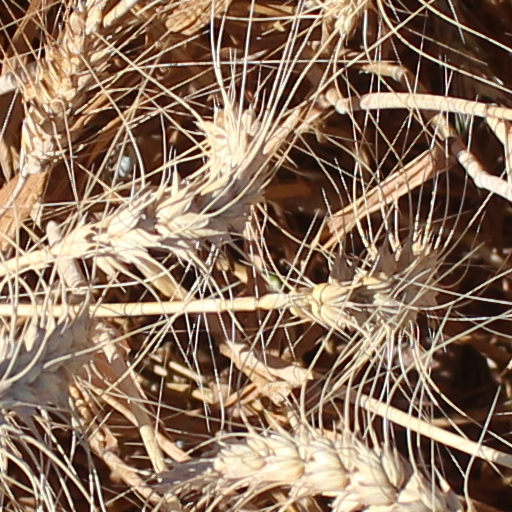
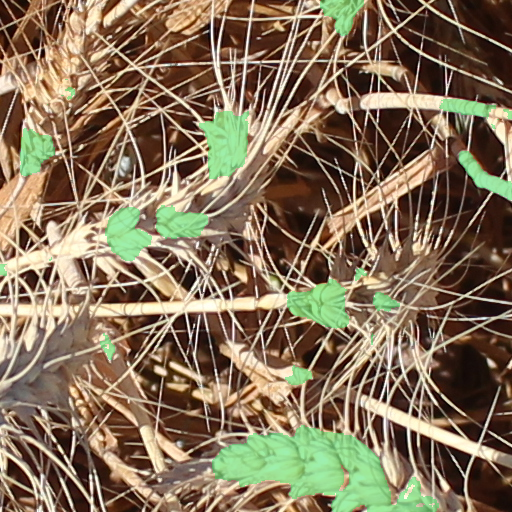

# 小麦麦穗分割与大麦影像分析

基于 PyTorch 和改进 U-Net 的麦穗像素分割应用，配套 Flask + Vue 3 界面、批量推理、结果下载和历史记录；另提供五通道大麦长势与倒伏区域分析。

| 原图 | 预测叠加图 |
| --- | --- |
|  |  |

这是已有本地推理记录，同一张输入与预测输出。绿色区域表示预测麦穗，单张展示不能代表总体精度。

## 实现内容

- 改进 U-Net、训练配置与多随机种子模型集成。
- 小麦 RGB 图像分割，输出二值 Mask 和叠加图。
- 大麦蓝、绿、红、红边、近红外五通道 TIFF 分析。
- Web 多图上传、历史记录、CSV 与图片下载。

大麦长势和倒伏按图块分析，不能等同于精细像素标注；不足完整图块的图像边缘有处理限制。小麦数据没有倒伏真值，不能用来证明倒伏任务效果。

## 运行准备

仓库包含源码与配置，**没有上传权重和完整训练数据**。先按照 [MODEL_ASSETS.json](MODEL_ASSETS.json) 将已有模型恢复到列出的相对路径，并核对 SHA256。模型未提供公开下载地址，此仓库不能直接从零下载全部权重。

Windows 建议 Python 3.12。目录内的 `install_dependencies.cmd` 和 `启动项目.cmd` 可建立环境并启动服务；依赖清单来自原本机 CUDA 13.0 环境，不保证适用于任意 GPU/驱动或全新机器。使用已有依赖环境时：

```powershell
cd C260928003程序
python app.py
```

打开 `http://127.0.0.1:5000`。`/api/health` 会报告各任务权重是否齐全；缺权重时服务处于 `degraded`，不能执行对应任务的真实推理。

## 代码与实验

- [模型与损失](C260928003程序/cropseg)
- [训练入口](C260928003程序/train.py)与[配置](C260928003程序/configs)
- [模型推理](C260928003程序/predict.py)、[大麦推理](C260928003程序/barley_inference.py)
- [Web API](C260928003程序/app.py)与[前端](C260928003程序/static)
- [已有实验产物](C260928003程序/reports)

`tests/test_release.py` 是需要本地模型和数据的集成测试，补齐资产后再执行；本次整理没有重新训练或重测模型。[原技术说明](C260928003程序/README.md)中的本机数据、权重和产物路径可能需要自行恢复。
