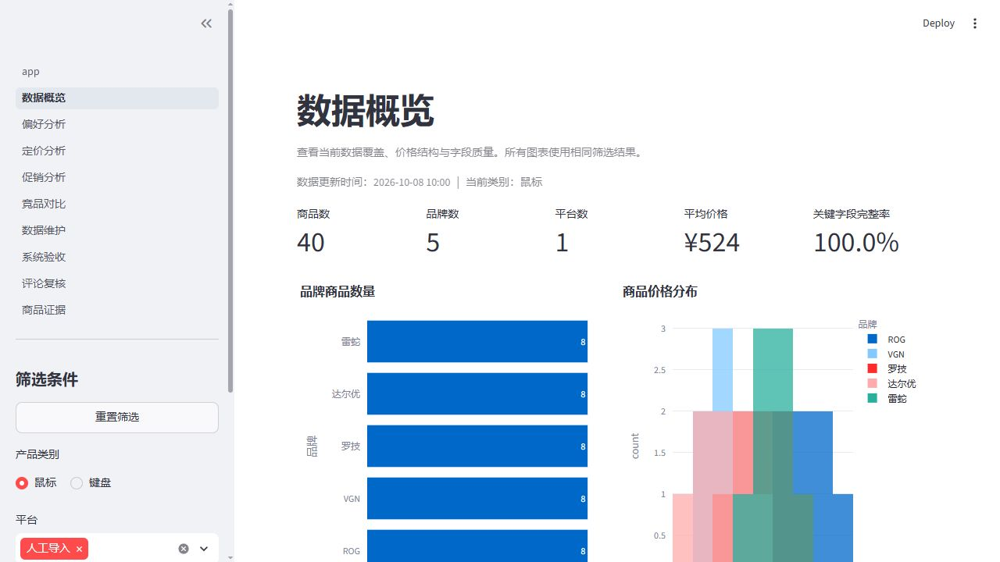

# Python / AI 应用作品集

三个项目展示数据处理、模型推理、可视化交互与结果导出的完整实现。可以先运行 **电竞外设竞品分析系统**：仓库内附演示数据，无需账号或模型权重。

| 项目 | 解决的问题 | 技术与实现 | 体验方式 |
| --- | --- | --- | --- |
| [电竞外设竞品分析](C261008001) | 汇总键鼠参数、价格与评论证据，支持比较与偏好匹配 | Python · Streamlit · SQLite · Pandas · Plotly；CSV 校验、数据溯源、可解释评分 | 内置合成数据演示；73 项测试通过 |
| [小麦麦穗分割与大麦分析](C260928003) | 从图像中提取麦穗区域，分析五通道大麦影像 | PyTorch · 改进 U-Net · 多种子集成 · Flask · Vue 3；批量推理和下载 | 源码与真实推理样例；运行需准备权重 |
| [农作物病害识别与病斑分割](S261003001) | 组合病害分类、病斑分割与可解释结果 | MobileNetV3 · DeepLabV3+ · Grad-CAM · Streamlit；低置信度复核和结果打包 | 源码与真实推理样例；运行需准备权重 |

## 先看效果

### 电竞外设：从数据到交互分析



实际启动应用后截取的界面。这里展示的是合成演示数据，鼠标与键盘各 40 个商品，每个商品 3 条历史报价；不代表真实市场价格或研究结果。真实评论与跨平台研究需要额外导入数据。

### 麦穗分割：原图与模型输出

| 输入图像 | 分割叠加结果 |
| --- | --- |
|  |  |

保存自已有本地推理结果，绿色区域为预测麦穗。单张样例用于展示输出形式，不能据此推断整体精度。

### 病害识别：病斑区域可视化


保存自已有本地验收结果，红色区域为预测病斑。Grad-CAM 关注区域与像素分割是不同输出；病斑占整图比例也不等于农学受害率。

## 运行可交互演示

建议 Python 3.12。以下命令适用于 PowerShell：

```powershell
git clone https://github.com/1z2zheng/python-ai-learning.git
cd python-ai-learning/C261008001
py -3.12 -m venv .venv
.venv/Scripts/python.exe -m pip install -r requirements.txt
.venv/Scripts/python.exe demo.py
```

打开终端显示的本地地址，默认 `http://localhost:8501`。演示会创建独立的 `data/demo.db`，不会写入正式数据库。其他系统可以用 `python3 -m venv .venv` 和 `.venv/bin/python` 替换对应命令。

可先进行无界面的数据检查：`python demo.py --prepare-only`。完整项目说明、正式数据导入方式和测试命令见 [键鼠项目 README](C261008001/README.md)。

## 阅读源码

- 数据与分析：[数据库与分析模块](C261008001/src/esports_analysis)、[分析页面](C261008001/pages)、[自动化测试](C261008001/tests)。
- 分割与服务：[麦穗模型](C260928003/C260928003程序/cropseg/model.py)、[推理](C260928003/C260928003程序/predict.py)、[Web API](C260928003/C260928003程序/app.py)。
- 分类与解释：[病害统一推理](S261003001/inference/predict.py)、[Grad-CAM](S261003001/inference/explain.py)、[交互应用](S261003001/app/streamlit_app.py)。

## 验证与运行边界

[验证记录](docs/verification.md)列出了本次实际执行的检查。键鼠项目已验证演示启动和 73 项测试；两个视觉项目在本次整理中展示已有输出，没有重新训练或重新测定精度。

仓库收录源码、配置、依赖、测试、必要的小型样例与展示图片。完整训练数据、模型权重、个人浏览器会话、虚拟环境、论文和 PPT 不随源码上传。视觉项目的必要权重路径和 SHA256 见各目录 `MODEL_ASSETS.json`；未准备权重时无法执行新的模型推理。这里提供仓库与本地运行方式，尚未部署公开在线 Demo。
